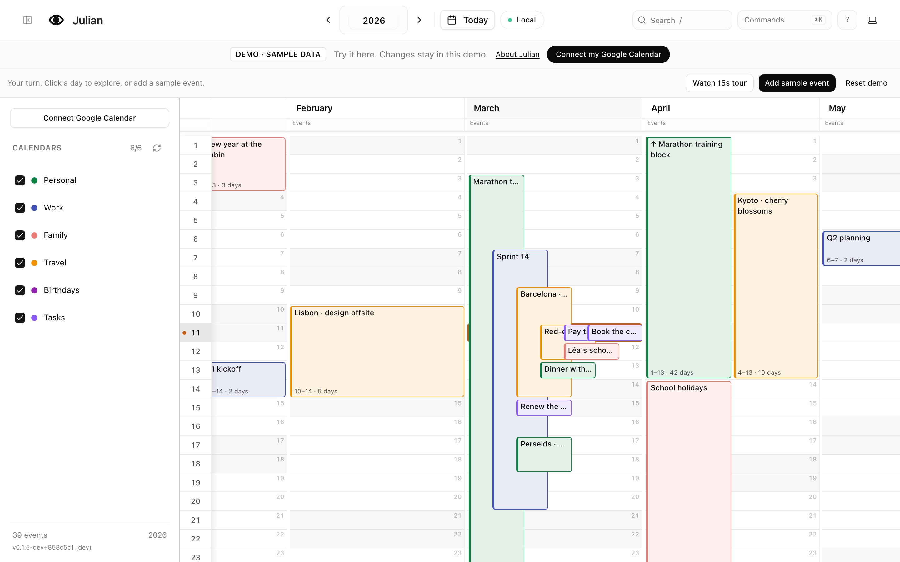
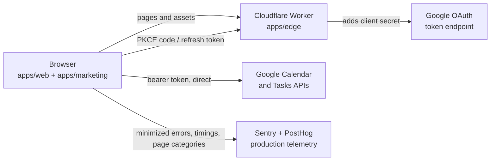

# Julian

[](https://github.com/krmznkr/julian/actions/workflows/ci.yml)
[](LICENSE)

**Your whole year on one screen.** Julian lays out Google Calendar events and
Google Tasks as a twelve-column year, so trips, sprints, and holidays read at a
glance. It is fully keyboard-driven, works on phones, and prints the year on a
single landscape page.

**[Try the live demo](https://julian.krmznkr.com/demo)**: no sign-in, sample
data, changes stay in your browser.

<picture>
  <source media="(prefers-color-scheme: dark)" srcset="docs/assets/year-dark.png">
  
</picture>

## Features

- **Year grid:** all-day, multi-day, and timed events laid out in lanes, one
  column per month, with Google Tasks on their due dates.
- **Keyboard first:** arrows, Home/End, type a day or month number, `/` to
  search, `?` for every shortcut.
- **Edit in place:** create, rename, delete, and drag an event to another day,
  with an optimistic update that rolls back if Google rejects it.
- **Readable URLs:** `/2026`, `/2026/03`, and a shareable `/demo/2026`.
- **Phones and print:** a touch layout and a one-page landscape print style.

## Why it's interesting

| Area              | What to look at                                                                                                                                                                                                                                                        |
| ----------------- | ---------------------------------------------------------------------------------------------------------------------------------------------------------------------------------------------------------------------------------------------------------------------- |
| Effect end to end | Google services as `Context.Service`s with live and test layers, tagged errors, retry `Schedule`s ([`packages/google`](packages/google)); UI loads run as fibers that cancel in-flight requests ([`use-latest-fiber.ts`](apps/web/src/lib/effect/use-latest-fiber.ts)) |
| Edge Worker       | One Effect pipeline: bot filter, rate limits, OAuth proxy with an origin lock, streamed body cap, `Schema`-validated grants, and a `Redacted` client secret ([`apps/edge`](apps/edge/src))                                                                             |
| Hexagonal UI      | The year view talks to ports; the live app plugs in Google, the demo plugs in an in-memory store, so the demo runs the real component ([`year-view-ports.ts`](apps/web/src/components/year-view/year-view-ports.ts))                                                   |
| Pure domain       | Date math and lane layout with no React or I/O, tested across five time zones ([`packages/domain`](packages/domain))                                                                                                                                                   |
| Security          | The client secret never reaches the browser; CSP and hardening headers defined once ([`packages/security`](packages/security)); threat model in [`docs/security.md`](docs/security.md)                                                                                 |
| Releases          | Semver from Conventional Commits, preview per PR, nightly channel, gradual stable rollout with automatic rollback ([`docs/releasing.md`](docs/releasing.md))                                                                                                           |

## Architecture



The browser calls Google directly with its own access token; the Worker only
serves assets and adds the client secret to token exchanges. There is no
database. Production uses Sentry for minimized errors and 5% sampled performance
traces, and cookieless PostHog page analytics. Calendar content, OAuth values and
personal state are excluded. See [`docs/observability.md`](docs/observability.md).
Details: [`docs/architecture.md`](docs/architecture.md).

## Repository layout

| Path                     | Purpose                                                   |
| ------------------------ | --------------------------------------------------------- |
| `apps/web`               | The calendar app: Vite, React 19, TanStack Router, Effect |
| `apps/marketing`         | Static home, privacy, and terms pages                     |
| `apps/edge`              | Cloudflare Worker: routing, OAuth proxy, protections      |
| `apps/e2e`               | Playwright, axe accessibility scans, Lighthouse CI        |
| `packages/domain`        | Pure calendar logic: dates, events, year-grid layout      |
| `packages/google`        | Effect services for Google OAuth, Calendar, and Tasks     |
| `packages/security`      | Security headers shared by the Worker and the build       |
| `packages/observability` | Production browser telemetry with privacy allowlists      |
| `packages/release`       | Version strings for each release channel                  |
| `packages/config`        | Shared TypeScript configuration                           |
| `infra`                  | Cloudflare resources as code (Alchemy, Effect)            |

## Quality gates

Every PR runs these in CI; coverage thresholds are per package and only go up.

| Check                                            | Command                   |
| ------------------------------------------------ | ------------------------- |
| oxlint, oxfmt, dead code, functional rules       | `bun run quality:static`  |
| TypeScript + Effect language-service diagnostics | `bun run typecheck`       |
| Unit tests with coverage thresholds              | `bun run test:coverage`   |
| Date tests in five time zones                    | `bun run test:tz:dates`   |
| End-to-end and accessibility (Playwright, axe)   | `bun run test:e2e`        |
| Lighthouse (performance, a11y, best practices)   | `bun run test:lighthouse` |

## Run locally

Prerequisites: Node 24.15.0 and [Bun](https://bun.com) 1.4.4 (both pinned in `mise.toml`).

```bash
git clone https://github.com/krmznkr/julian.git
cd julian
bun install
bun run dev
```

Open `http://127.0.0.1:3000/demo`. Signing in with Google locally needs the
OAuth setup in [`docs/development.md`](docs/development.md).

## Documentation

- [`docs/architecture.md`](docs/architecture.md): request pipeline, OAuth
  sequence, data flow, storage, failure behavior.
- [`docs/development.md`](docs/development.md): setup and commands.
- [`docs/releasing.md`](docs/releasing.md): versioning, channels, rollout, rollback.
- [`docs/infrastructure.md`](docs/infrastructure.md): Cloudflare as code with Alchemy.
- [`docs/observability.md`](docs/observability.md): telemetry privacy and private source maps.
- [`docs/security.md`](docs/security.md): threat model, edge hardening, smoke tests.
- [`docs/follow-ups.md`](docs/follow-ups.md): known gaps and manual steps.
- [`docs/roadmap.md`](docs/roadmap.md): what is done and what is next.

See [`CONTRIBUTING.md`](CONTRIBUTING.md), [`SUPPORT.md`](SUPPORT.md), and
[`SECURITY.md`](SECURITY.md) for contributing, help, and private vulnerability
reports.

## License

[MIT](LICENSE)
