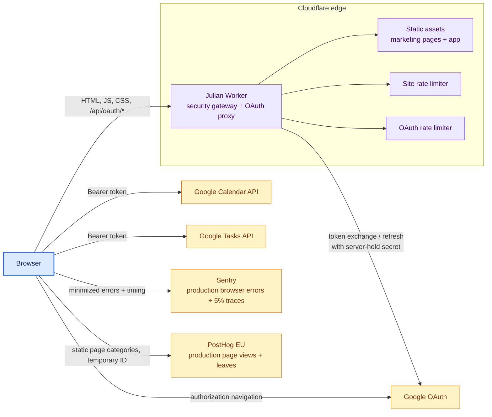
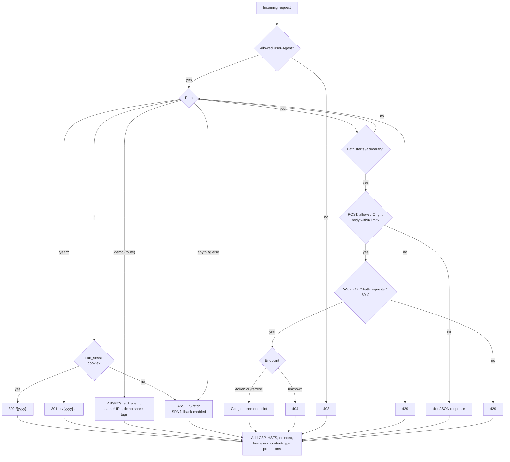
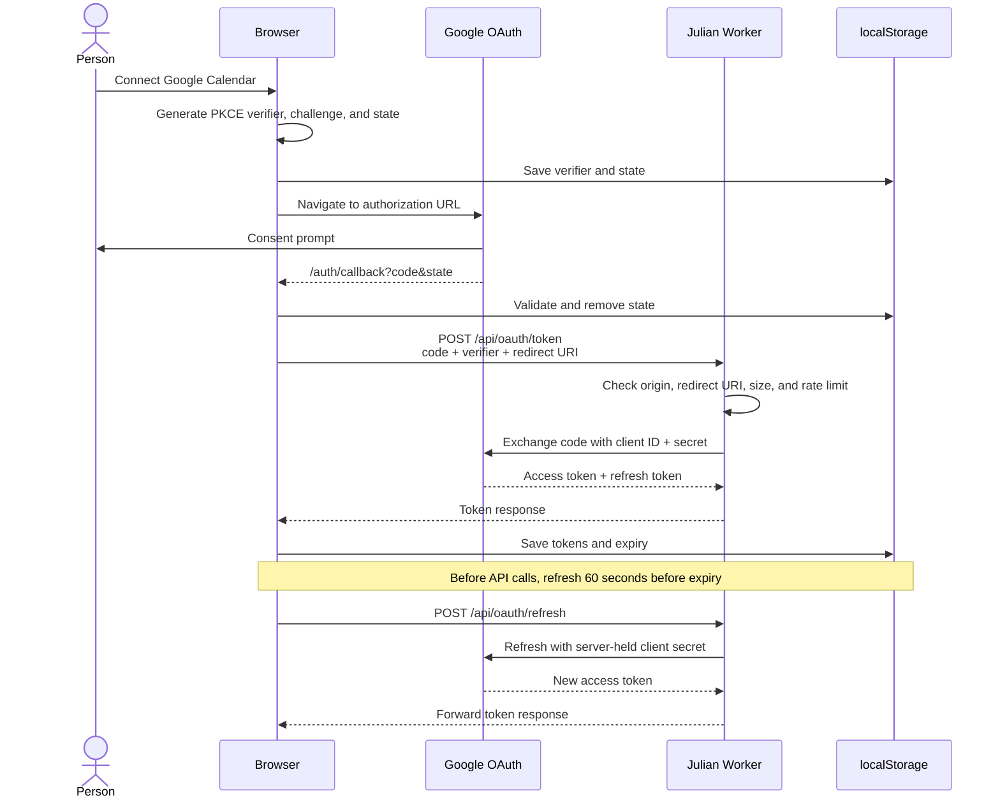
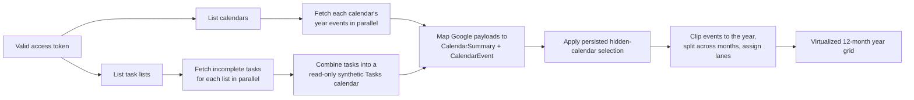
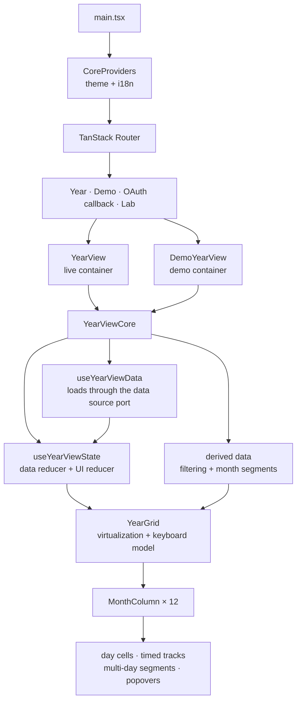
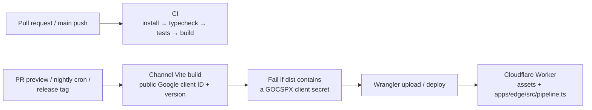

# Architecture

Julian is a browser-rendered React application served by a Cloudflare Worker.
The browser talks directly to Google Calendar and Google Tasks after
authentication; the Worker is deliberately small and exists to protect the
static site and keep the confidential OAuth client secret out of the bundle.

## System context

There is no application database, server session, queue, KV namespace, or
durable object. Calendar data remains in Google; the browser keeps OAuth tokens
and UI preferences in local storage.

## Edge request pipeline

`assets.run_worker_first` ensures static files cannot bypass the Worker.

Every exit path receives the same security headers. See
[`security.md`](security.md) for the exact allowlists, rate limits, headers,
verification commands, and accepted token-storage risk.

## OAuth authorization and refresh

The Worker never stores a token. It adds the confidential client secret to a
same-origin exchange and forwards Google's response. `state` protects the
callback, and PKCE binds the authorization code to the browser that started the
flow.

## Calendar data flow

Calendar/event fetch failures are isolated per calendar, and task-list failures
are isolated per list. A partial year can therefore render even when one Google
resource fails. Each isolated failure is recorded in the load result's
`failures`, carried through the data port into view state, and reported by the
sidebar's sync badge — so a partially loaded year is visibly partial rather than
looking like an empty one. Creating, renaming, and deleting events call the
Calendar API directly, then update the reducer-backed view state. Google Tasks
are read-only in Julian.

Moving an all-day event is optimistic (`year-view/use-event-move.ts`): the
reducer moves it at once, `YearViewEventApi.moveEvent` PATCHes its dates as a
fiber, and a failed or interrupted write moves it back and shows an alert.
Moves run independently, so a second drag never cancels the first one's write.
The grid root handles HTML drag-and-drop for writable all-day chips; `M` in day
details, or "Move to another day" in the details pane on touch, opens a dialog
with a date field instead.

Search (`year-view/event-search.tsx`) filters the visible events by title and
description before month segmentation, and a context hands the query to the
chips, which wrap matches in `<mark>`. `/` focuses the field; Escape clears it
and returns focus to the grid.

Printing renders every month (virtualization stands down between
`beforeprint` and `afterprint`) and a print stylesheet shrinks the columns and
rows to fit one A4 landscape page.

## Frontend composition

The domain layer in `packages/domain/src/` owns date parsing, event normalization,
composite event keys, year clipping, month segmentation, and greedy lane
assignment. Components consume those results rather than duplicating calendar
math.

### Year-view ports

`YearViewCore` holds the entire year view but no opinion about where its data
and its focus live. Three ports in
`apps/web/src/components/year-view/year-view-ports.ts` supply that, so the same component
serves both the signed-in app and the demo:

| Port                  | Live container (`year-view/google-ports.ts`) | Demo container (`landing/demo-year-view.tsx`) |
| --------------------- | -------------------------------------------- | --------------------------------------------- |
| `YearViewRouterPort`  | TanStack Router search params                | local `useState`                              |
| `YearViewDataSource`  | Google Calendar + stored calendar selection  | generated fixture year, in memory             |
| `YearViewEventApi`    | Google create/update/move/delete             | in-memory store                               |
| `YearViewPreferences` | `localStorage` sidebar preference            | in-memory ref                                 |

Loads and writes are `Effect` values with no requirements and a typed failure
(a `_tag` and a message). The live ports get the app services from the shared
`ManagedRuntime` through `provideApp`; the demo ports are `Effect.sync`. The
hooks fork each one through `useLatestFiber`: a newer load interrupts the older
one, unmounting interrupts whatever is running, and the effect dispatches its
own result, so an interrupted fiber can never write stale data. Interruption
also aborts the in-flight `fetch` through the HTTP client's `AbortSignal`.

The demo therefore demonstrates the product by running it, not by
reimplementing it — a lookalike would drift from the real view on every change.

### Landing demo

The marketing home links to `/demo`; it cannot frame the demo because every
response forbids framing. The demo page is labelled "Demo · Sample data". A three-step tour opens
today, creates a sample event, and opens commands. It runs once in under 15
seconds. "Try it now" stops it immediately; "Add sample event" opens the same
form as the N shortcut; "Reset demo" starts a fresh in-memory session.

The tour in `demo-script.ts` is an Effect program: each pause is an
`Effect.sleep`, the player runs it as one fiber and interrupts it to hand over
control, and its tests drive the timeline with `TestClock`. `demo-input.ts`
dispatches keyboard events through the application's handlers.
Any trusted input, including a login click, cancels the tour before the action
continues. A hidden tab or scrolling away also cancels it. Touch devices,
small screens, and reduced-motion preferences start in interactive mode.
Events are kept per year for the visit, including edits made after navigating
to another year. Refreshing the page or resetting the demo discards them.

### Event dates and display

- All-day `date` values are calendar dates, without a timezone conversion.
- Timed `dateTime` values are instants displayed in the browser's local timezone,
  named in the event details. They can legitimately fall on a different date
  than the original calendar's timezone.
- Both kinds use an exclusive end. An event ending at midnight does not occupy
  the next day. Calendar-day counts use date boundaries, including DST days.
- Multi-day classification applies to the whole event. A one-day tail at a
  month or year boundary stays a bar, with arrows marking continuation.
- Month cells show only all-day events. Timed appointments remain available in
  the day details dialog but do not add visual noise to the year grid. All-day
  multi-day events use lanes; busy all-day cells show a `+N` button. Clicking an
  event selects it in the day panel. Opening Google is an explicit action from
  the details panel.
- The component examples at `/lab` (dev server only) use the same date and rendering code.

### Route behavior

One domain serves two builds. The marketing pages are static HTML from
`apps/marketing`; everything else is the React app.

| Route                         | Served by | Purpose                                                                   |
| ----------------------------- | --------- | ------------------------------------------------------------------------- |
| `/`                           | Worker    | Marketing home, or `302 /{yyyy}` when the `julian_session` cookie is set  |
| `/home`, `/privacy`, `/terms` | marketing | Static pages with production-only telemetry                                               |
| `/{yyyy}`                     | app       | Lazy-loaded year view; the current year adds today's month/day to the URL. Signed out, it offers sign-in or the demo |
| `/{yyyy}/{mm}`                | app       | Redirects to `/{yyyy}?month=mm&day=1`                                     |
| `/year/*`                     | Worker    | `301` to the same path without `/year`, query kept (legacy bookmarks)     |
| `/demo`, `/demo/{yyyy}`       | app       | The real year view on sample data; `/demo` opens the current year. The Worker serves route-like `/demo/…` paths the `/demo` page, keeping the external URL and query while supplying the demo's title and canonical `og:url` `/demo`. File-like paths keep their existing handling |
| `/demo/{yyyy}/{mm}`           | app       | Redirects to `/demo/{yyyy}?month=mm&day=1`                                |
| `/auth/callback`              | app       | Validates OAuth state and exchanges the single-use code                   |
| `/api/oauth/*`                | Worker    | Token exchange and refresh                                                |
| `/lab`                        | app       | Component/design experimentation; dev server only, absent from builds     |

`julian_session` (`packages/security/src/session-hint.ts`) is a hint, not a
credential: its value is `1`, it is set after a successful sign-in (and whenever
the year view confirms a stored session), and cleared on logout. The `/`
response varies by cookie, so it is `private, no-store`. The year view still
performs the full authenticated check once it mounts. Under the Vite servers,
which do not run the Worker, the app's own `/` route redirects to the year or
the demo from `localStorage` instead, and `/year/*` redirects client-side.

Search parameters hold the focused month/day so the selected date is linkable.
The Worker serves `index.html` for unknown paths on navigations, allowing
client-side routes to load directly. A non-navigation request for a missing file
(`/nope.js`, `/_headers`, `/.env`) gets a plain `404` instead.

`index.html` (and `demo.html`, built from it) paints the "Loading calendar..."
screen inside `#root` before any script runs, so the first paint waits only for
the HTML, the stylesheet and `/bootstrap.js`, not for the app's JavaScript.
React replaces it on mount. It is the same markup as `RouteLoading`
(`src/features/shell/route-loading.tsx`); a unit test keeps the two in step.
Without JavaScript the page says the calendar needs it instead.

Content-hashed scripts and styles (`/assets/<name>-<hash>.js|css` and the same
under `/_marketing/`) leave the Worker with `public, max-age=31536000,
immutable` (`apps/edge/src/cache.ts`), so a returning visitor loads them from
the browser cache without a request. Only a 200 or 304 answer to a GET or HEAD
with no query string and a JavaScript or CSS type qualifies. HTML,
`/bootstrap.js`, `/version.json`, other files, redirects and errors keep their
revalidating or `no-store` headers. The web build fails if `public/` places
files in either directory, so only the bundler writes there.

## Browser storage

| Key / family                       | Contents                  | Lifetime                                          |
| ---------------------------------- | ------------------------- | ------------------------------------------------- |
| `google:access_token`              | Google access token       | Until logout, refresh failure, or manual clearing |
| `google:refresh_token`             | Google refresh token      | Until logout, refresh failure, or revocation      |
| `google:expires_at`                | Access-token expiry epoch | Updated after token exchange/refresh              |
| `google:pkce_verifier`             | PKCE verifier             | Removed after successful callback                 |
| `google:oauth_state`               | Anti-forgery state        | Removed when callback is handled                  |
| calendar-selection key             | Hidden calendar IDs       | Persistent UI preference                          |
| `julian.yearView.sidebarCollapsed` | Sidebar state             | Persistent UI preference                          |
| theme preference                   | Theme selection           | Managed by the theme provider                     |

No event title, description, or calendar contents are deliberately persisted by
Julian. The OAuth token rows are security-sensitive; the strict script CSP is a
load-bearing control.

## Build and deployment

`apps/marketing` builds first (Turborepo orders it as a dependency of
`@julian/web`); the web build then copies its pages and `_marketing/` assets
into `apps/web/dist`, the Worker's single assets directory. Workers static
assets serves `home.html` at `/home`, so no second binding or routing table is
needed, and the client-secret scan covers both sites. The web build produces
split chunks for React, TanStack Router, Radix, icons, and other vendors. CI runs type checks, tests, and a build. Each release channel
(preview, nightly, stable) builds again with the public OAuth client ID and its
version metadata, scans the output for a Google client-secret pattern, and only
then uploads or deploys. Channels, gradual rollout and rollback are described in
[`releasing.md`](releasing.md).

### Configuration by phase

| Value                   | Local development                      | GitHub Actions                  | Worker runtime                       |
| ----------------------- | -------------------------------------- | ------------------------------- | ------------------------------------ |
| `VITE_GOOGLE_CLIENT_ID` | `.env` from `.env.example`             | Public value in deploy workflow | Embedded in static JS                |
| `GOOGLE_CLIENT_ID`      | Wrangler variable                      | `infra/src/config.ts`           | Worker binding                       |
| `GOOGLE_CLIENT_SECRET`  | Optional local Wrangler secret         | Never supplied to build         | Encrypted Worker secret              |
| `CLOUDFLARE_API_TOKEN`  | Operator environment for manual deploy | Environment secret              | Consumed by Wrangler, not the Worker |

Stable production pages use Sentry for minimized browser errors and 5% sampled
performance traces, and cookieless PostHog page analytics. Calendar content,
OAuth values and personal state are excluded by payload allowlists shared in
`packages/observability`. The Worker has no telemetry SDK. See
[`observability.md`](observability.md) for the data contract, production gate
and private source-map upload. GitHub Actions and the smoke tests in
[`security.md`](security.md) remain the deployment evidence.

## Failure behavior

| Failure                   | User-visible result                             | Recovery                                 |
| ------------------------- | ----------------------------------------------- | ---------------------------------------- |
| No stored Google token    | Empty calendar view with a connect action       | Start OAuth                              |
| Expired access token      | Automatic refresh through Worker                | Reconnect if refresh fails               |
| Revoked token (401)       | Load or write reports a not-authenticated error | Reconnect                                |
| One calendar fetch fails  | Other calendars and tasks still render          | Retry/reload calendars                   |
| One task list fails       | Other task lists still render                   | Retry/reload                             |
| OAuth proxy misconfigured | Callback or refresh reports failure             | Restore Worker secret/config             |
| Mutation fails            | Existing state remains and an error is surfaced | Retry after checking access role/network |
| Move fails                | Event returns to its old day; alert explains    | Retry after checking access role/network |
| Render failure            | Route/year error boundary                       | Retry or reload                          |

## Where to change things

| Change                                           | Primary files                                                                                               |
| ------------------------------------------------ | ----------------------------------------------------------------------------------------------------------- |
| OAuth scopes, token lifecycle, Google mapping    | `packages/google/src/`                                                                                      |
| Edge routing, OAuth allowlist, security headers  | `apps/edge/src/*.ts`, `packages/security/src/index.ts`, `infra/src/config.ts`                               |
| Route structure and URL contract                 | `apps/web/src/router.tsx`, `apps/web/src/lib/year-view-url.ts`                                              |
| Calendar math and event segmentation             | `packages/domain/src/`                                                                                      |
| Year-view state and orchestration                | `apps/web/src/components/year-view-reducer.ts`, `apps/web/src/components/year-view-core.tsx`                |
| Where the year view gets data, focus, and writes | `apps/web/src/components/year-view/year-view-ports.ts`, `apps/web/src/components/year-view/google-ports.ts` |
| Demo page and its scripted tour                  | `apps/web/src/routes/demo-page.tsx`, `apps/web/src/components/landing/`                                     |
| Marketing, privacy, and terms pages              | `apps/marketing/*.html`, `apps/marketing/src/partials.ts`                                                   |
| `/` routing, legacy redirects, session hint      | `apps/edge/src/site.ts`, `packages/security/src/session-hint.ts`                                            |
| Month rendering and virtualization               | `apps/web/src/components/year-view/`                                                                        |
| Build chunking, asset assembly, and deployment   | `apps/web/vite.config.ts`, `.github/actions/build-web`, `.github/workflows/deploy-stable.yml`               |

## Related documentation

- [`development.md`](development.md) — local commands and focused workflows.
- [`security.md`](security.md) — threat model, concrete edge controls, and smoke
  tests.
- [`follow-ups.md`](follow-ups.md) — open operational and security items.
