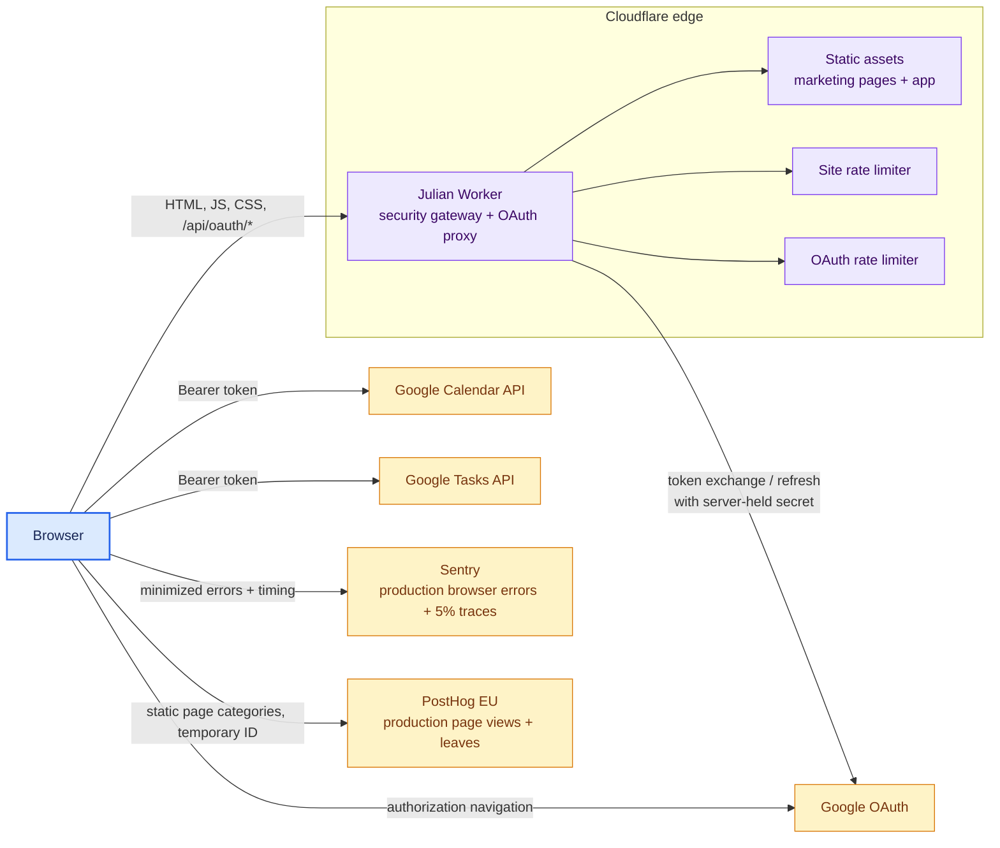
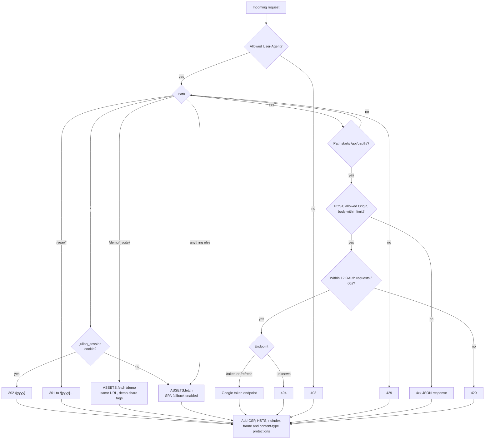
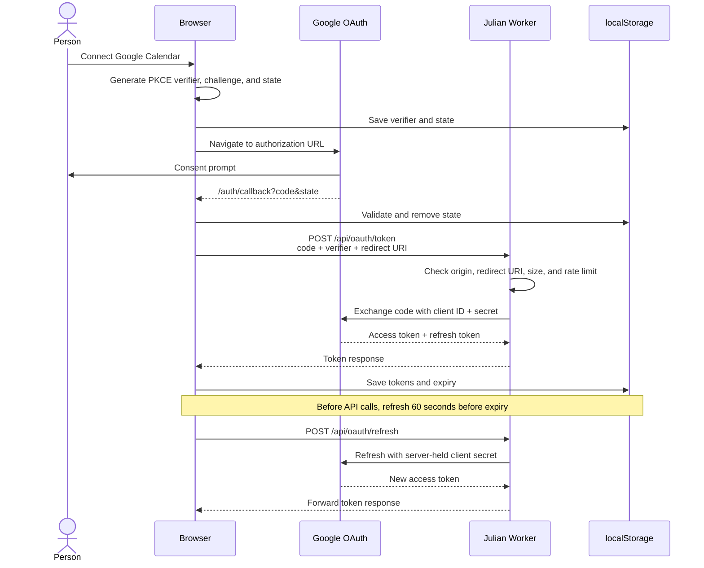
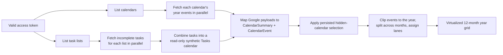
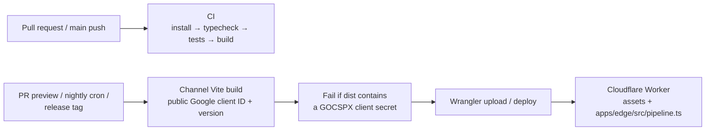

# Architecture

Julian is a browser-rendered Foldkit application served by a Cloudflare Worker.
The browser talks directly to Google Calendar and Google Tasks after
authentication; the Worker is deliberately small and exists to protect the
static site and keep the confidential OAuth client secret out of the bundle.

## System context

There is no application database, server session, queue, KV namespace, or
durable object. Calendar data remains in Google; the browser keeps OAuth tokens
and UI preferences in local storage.

## Edge request pipeline

`assets.run_worker_first` ensures static files cannot bypass the Worker.

Every exit path receives the same security headers. See
[`security.md`](security.md) for the exact allowlists, rate limits, headers,
verification commands, and accepted token-storage risk.

## OAuth authorization and refresh

The Worker never stores a token. It adds the confidential client secret to a
same-origin exchange and forwards Google's response. `state` protects the
callback, and PKCE binds the authorization code to the browser that started the
flow.

## Calendar data flow

Calendar/event fetch failures are isolated per calendar, and task-list failures
are isolated per list. A partial year can therefore render even when one Google
resource fails. Each isolated failure is recorded in the load result's
`failures`, carried through the data port into view state, and reported by the
sidebar's sync badge — so a partially loaded year is visibly partial rather than
looking like an empty one. Creating, renaming, and deleting events call the
Calendar API directly, then update the immutable Model. Google Tasks
are read-only in Julian.

Moving an all-day event is optimistic: `update` in `foldkit/app.ts` moves it
at once, the `MoveEvent` Command PATCHes its dates through
`YearViewEventApi.moveEvent` as a fiber, and a failed or interrupted write moves it back and shows an alert.
Moves run independently, so a second drag never cancels the first one's write.
The grid root handles HTML drag-and-drop for writable all-day chips; `M` in day
details, or "Move to another day" in the details pane on touch, opens a dialog
with a date field instead.

Search filters the visible events by title, description and calendar name
before month segmentation (`visibleEvents` in `foldkit/model.ts`), and the
chips wrap matches in `<mark>`. `/` focuses the field; Escape clears it
and returns focus to the grid.

Printing renders every month (virtualization stands down between
`beforeprint` and `afterprint`) and a print stylesheet shrinks the columns and
rows to fit one A4 landscape page.

## Frontend composition

`apps/web/src/main.ts` boots one Foldkit application. The runtime renders the
Schema-defined Model, dispatches typed Messages to the pure update function,
and runs the returned Commands as scoped Effect fibers. Browser events enter
through subscriptions, which the runtime releases on disposal. There are no
React roots, hooks, component libraries or TanStack routes.

| Module | Responsibility |
| --- | --- |
| `foldkit/model.ts` | Schema state, Messages and derived event selection |
| `foldkit/app.ts` | Pure transitions, navigation, edits and optimistic rollback |
| `foldkit/routing.ts` | URL validation and canonical calendar links |
| `foldkit/commands.ts` | Loads, writes, OAuth, storage, focus and scrolling |
| `foldkit/subscriptions.ts` | Keyboard, drag/drop, resize, scroll, media and print events |
| `foldkit/view.ts`, `grid-view.ts`, `timeline-view.ts`, `dialogs.ts` | Pure HTML rendering |
| `foldkit/services.ts` | Browser services and the in-memory demo adapter |

The Foldkit runtime owns navigation through typed URL-request and URL-change
Messages. The existing year and month validators preserve `/demo`,
`/demo/{year}`, `/{year}`, month shortcuts and legacy `/year/{year}` links.
Focus, open day details and the timeline layout round-trip through search
parameters. Back and forward update the same Model. Marketing links perform
a full navigation to their prerendered HTML pages.

### Data and writes

The shared data and event ports remain in
`components/year-view/year-view-ports.ts`. `CalendarPorts` selects the Google
adapters for signed-in routes and an Effect Ref store for the demo. Google
requests still use the existing service graph in `lib/effect/runtime.ts`.
Calendar content stays in the browser; no new server or storage is involved.

`LoadYear` is declared interruptible, but nothing sends `LoadYear.Interrupt`
yet, so a newer load does not cancel its predecessor. Load IDs and years
reject stale completions. Partial source failures remain
visible beside the calendar list. Refreshes merge outstanding optimistic
moves instead of overwriting them with an older API response.

Create, rename and delete keep their dialog open on failure so the visitor can
retry. Moves update the Model immediately and retain their original dates by
operation ID. Writes to different events run independently; another move of
the same event waits for its pending save. A failed move rolls back only its
dates, preserving concurrent edits and other events. Completions from another
displayed year cannot replace the current year's data.

### Keyboard, dialogs and display

The year grid remains a focusable application with an active-descendant date.
Keyboard navigation, typeahead, search, commands and timeline controls dispatch
Messages. Text inputs retain their own keys, and checkbox controls keep global
shortcuts available. The modal calendars drawer uses Foldkit's DOM helpers to
trap focus, isolate the page and restore focus when it closes. Day details
suspend while a modal is open and retain their selection when they resume.

Month columns are virtualized from the scroll position with the focused month
kept mounted. The print subscription mounts all twelve months and the print
stylesheet fits them on one landscape page. The grid and details use the same
domain segments, including the rule for short events crossing midnight.
Timeline packing and date arithmetic continue to use `packages/domain`.

### Demo

The demo uses the same update and view with seeded sample data. Its Ref store
supports creation, renaming, moves and deletion for each visited year. Edits
and hidden-calendar choices survive navigation and refresh within the visit;
Reset demo restores the fixture state. No demo state is persisted to disk.
The tour is a sequence of interruptible timer Commands. User interaction
stops it, and autoplay respects reduced motion and narrow screens.

### Privacy at the runtime boundary

Foldkit DevTools and the MCP bridge are disabled. Runtime crash reporting
forwards only the Error to the existing allowlisted telemetry wrapper. It
never forwards the Model or Message. OAuth callback codes are read inside the
callback Effect and are not copied into the Model's URL field.

## Browser storage

| Key / family                       | Contents                  | Lifetime                                          |
| ---------------------------------- | ------------------------- | ------------------------------------------------- |
| `google:access_token`              | Google access token       | Until logout, refresh failure, or manual clearing |
| `google:refresh_token`             | Google refresh token      | Until logout, refresh failure, or revocation      |
| `google:expires_at`                | Access-token expiry epoch | Updated after token exchange/refresh              |
| `google:pkce_verifier`             | PKCE verifier             | Removed after successful callback                 |
| `google:oauth_state`               | Anti-forgery state        | Removed when callback is handled                  |
| calendar-selection key             | Hidden calendar IDs       | Persistent UI preference                          |
| `julian.yearView.sidebarCollapsed` | Sidebar state             | Persistent UI preference                          |
| theme preference                   | Theme selection           | Managed by the theme provider                     |

No event title, description, or calendar contents are deliberately persisted by
Julian. The OAuth token rows are security-sensitive; the strict script CSP is a
load-bearing control.

## Build and deployment

`apps/marketing` builds first (Turborepo orders it as a dependency of
`@julian/web`); the web build then copies its pages and `_marketing/` assets
into `apps/web/dist`, the Worker's single assets directory. Workers static
assets serves `home.html` at `/home`, so no second binding or routing table is
needed, and the client-secret scan covers both sites. The web build produces
separate chunks for Foldkit, Effect and observability. CI runs type checks, tests, and a build. Each release channel
(preview, nightly, stable) builds again with the public OAuth client ID and its
version metadata, scans the output for a Google client-secret pattern, and only
then uploads or deploys. Channels, gradual rollout and rollback are described in
[`releasing.md`](releasing.md).

### Configuration by phase

| Value                   | Local development                      | GitHub Actions                  | Worker runtime                       |
| ----------------------- | -------------------------------------- | ------------------------------- | ------------------------------------ |
| `VITE_GOOGLE_CLIENT_ID` | `.env` from `.env.example`             | Public value in deploy workflow | Embedded in static JS                |
| `GOOGLE_CLIENT_ID`      | Wrangler variable                      | `infra/src/config.ts`           | Worker binding                       |
| `GOOGLE_CLIENT_SECRET`  | Optional local Wrangler secret         | Never supplied to build         | Encrypted Worker secret              |
| `CLOUDFLARE_API_TOKEN`  | Operator environment for manual deploy | Environment secret              | Consumed by Wrangler, not the Worker |

Stable production pages use Sentry for minimized browser errors and 5% sampled
performance traces, and cookieless PostHog page analytics. Calendar content,
OAuth values and personal state are excluded by payload allowlists shared in
`packages/observability`. The Worker has no telemetry SDK. See
[`observability.md`](observability.md) for the data contract, production gate
and private source-map upload. GitHub Actions and the smoke tests in
[`security.md`](security.md) remain the deployment evidence.

## Failure behavior

| Failure                   | User-visible result                             | Recovery                                 |
| ------------------------- | ----------------------------------------------- | ---------------------------------------- |
| No stored Google token    | Sign-in screen with a demo link       | Start OAuth                              |
| Expired access token      | Automatic refresh through Worker                | Reconnect if refresh fails               |
| Revoked token (401)       | Load or write reports a not-authenticated error | Reconnect                                |
| One calendar fetch fails  | Other calendars and tasks still render          | Retry/reload calendars                   |
| One task list fails       | Other task lists still render                   | Retry/reload                             |
| OAuth proxy misconfigured | Callback or refresh reports failure             | Restore Worker secret/config             |
| Mutation fails            | Existing state remains and an error is surfaced | Retry after checking access role/network |
| Move fails                | Event returns to its old day; alert explains    | Retry after checking access role/network |
| Render failure            | Foldkit crash view; Sentry gets the error       | Reload                                   |

## Where to change things

| Concern | Path |
| --- | --- |
| State and user interactions | `apps/web/src/foldkit/model.ts`, `app.ts` |
| Loads, writes and browser effects | `apps/web/src/foldkit/commands.ts`, `services.ts` |
| Routing and keyboard | `apps/web/src/foldkit/routing.ts`, `subscriptions.ts` |
| Calendar rendering and styles | `apps/web/src/foldkit/*view.ts`, `dialogs.ts`, `src/styles/globals.css` |
| Pure dates and lane layout | `packages/domain` |
| Google I/O and OAuth | `packages/google` |
| Build, assets and deployment | `apps/web/vite.config.ts`, `.github/workflows` |

## Related documentation

- [`development.md`](development.md) — local commands and focused workflows.
- [`security.md`](security.md) — threat model, concrete edge controls, and smoke
  tests.
- [`follow-ups.md`](follow-ups.md) — open operational and security items.
