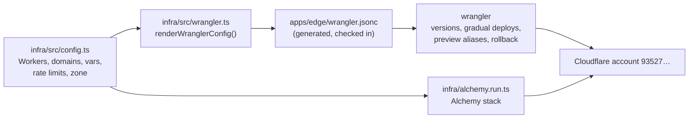

# Infrastructure

Cloudflare is described in code in [`infra/`](../infra), a workspace package
built on [Alchemy](https://alchemy.run) v2 (Effect-native, beta). Two tools share
one source of truth:



## Who owns what

| Resource                                                          | Declared in            | Applied by                     |
| ----------------------------------------------------------------- | ---------------------- | ------------------------------ |
| Workers `julian` and `julian-nightly`                             | `infra/src/config.ts`  | wrangler (`deploy`/`versions`) |
| Assets (`../web/dist`, `run_worker_first`, SPA fallback)          | `infra/src/config.ts`  | wrangler                       |
| `SITE_RATELIMIT` (240/60s), `OAUTH_RATELIMIT` (12/60s)            | `infra/src/config.ts`  | wrangler                       |
| `GOOGLE_CLIENT_ID` var                                            | `infra/src/config.ts`  | wrangler                       |
| `GOOGLE_CLIENT_SECRET` secret                                     | name only, never value | `wrangler secret put`          |
| Custom domains `julian.krmznkr.com`, `julian-nightly.krmznkr.com` | `infra/src/config.ts`  | wrangler                       |
| Zone `krmznkr.com` (adopted, retained)                            | `infra/alchemy.run.ts` | Alchemy                        |
| Managed `robots.txt` (bot management)                             | `infra/alchemy.run.ts` | Alchemy                        |

### Why wrangler still deploys the Workers

The release flow in [`releasing.md`](releasing.md) depends on things only
wrangler does: `wrangler versions upload` + `versions deploy` for gradual
rollout, `--preview-alias` for PR previews, per-deploy `--var` for
`APP_VERSION`/`APP_CHANNEL`/`APP_COMMIT`, and `wrangler rollback`. If Alchemy
also owned the Worker scripts, every Alchemy apply would deploy a new version at
100% and race those flows. So Alchemy owns the zone, and the Worker shape lives
in `config.ts` and is rendered into `apps/edge/wrangler.jsonc`.

`wrangler.jsonc` is generated. Edit `infra/src/config.ts`, then:

```sh
pnpm --filter @julian/infra wrangler:generate   # rewrite the file
pnpm --filter @julian/infra wrangler:check      # fail if it is stale
```

A unit test (`infra/src/wrangler.test.ts`) also fails when the checked-in file
drifts from the config, so `pnpm test:coverage` catches a forgotten regenerate.

## State and adoption

- **State store:** `Cloudflare.state()` keeps stack state in a small Worker in
  the same account, so local runs and CI see the same state. The store's auth
  token lives in a Cloudflare Secrets Store, not in the repo.
- **Adoption:** the zone already exists, so it is declared with
  `adopt(true)`: the first apply takes it over instead of creating it, and
  removing it from the stack never deletes it.
- **No destroy:** no workflow runs `alchemy destroy`. Do not run it by hand
  against `prod`.

## CI

| Workflow              | When                                                        | Does                            |
| --------------------- | ----------------------------------------------------------- | ------------------------------- |
| `infra.yml` → `plan`  | PRs touching `infra/`, `apps/edge/`, the lockfile; dispatch | `alchemy plan`                  |
| `infra.yml` → `apply` | Manual dispatch with `apply: true` (`production` env)       | `alchemy deploy --yes`          |
| `deploy-stable.yml`   | Release                                                     | `alchemy deploy`, then wrangler |
| `nightly.yml`         | Nightly schedule                                            | `alchemy deploy`, then wrangler |

Every Alchemy step is gated on the repository variable `ALCHEMY_ENABLED ==
'true'`, so nothing runs until the owner bootstraps the state store. Fork PRs
and runs without `CLOUDFLARE_API_TOKEN` skip the plan instead of failing.

## Validating offline

Without credentials, `pnpm typecheck` checks the stack against Alchemy's types
and `pnpm --filter @julian/infra test:run` checks the config and the generated
wrangler file. `alchemy plan` needs a token.

## One-time owner steps

1. **Widen the Cloudflare API token** stored as the `CLOUDFLARE_API_TOKEN`
   repository secret (account `93527…`) to also cover Zone Read, Zone Settings
   Edit, Bot Management Edit, Workers Scripts Edit and Secrets Store Edit (the
   last two are for the state store). `pnpm --filter @julian/infra exec alchemy
cloudflare token` can create one interactively.
2. **Bootstrap the state store** once from a laptop with that token:
   `CLOUDFLARE_ACCOUNT_ID=93527c9983d1c08638cb9c1de99f0450 pnpm --filter
@julian/infra exec alchemy cloudflare bootstrap`.
3. **Check the adoption plan:** `pnpm --filter @julian/infra run plan`. It should
   show the zone adopted and bot management updated in place, nothing created
   or deleted.
4. **Apply once:** `pnpm --filter @julian/infra run deploy`.
5. **Turn CI on:** set the repository variable `ALCHEMY_ENABLED` to `true`.
