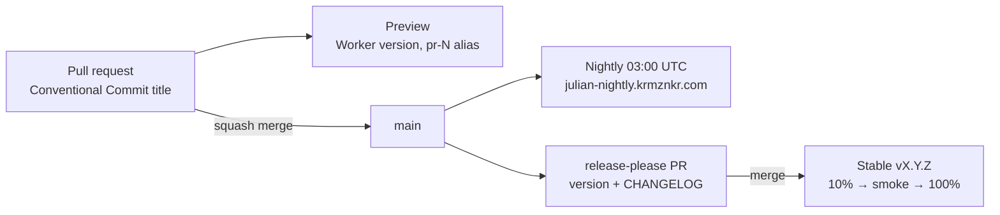

# Releasing

Julian ships from one product version through three channels. Everything here is
automated by GitHub Actions; the only manual step is merging the release PR.



## Versioning

- One version for the product: `version` in the root `package.json`, tracked by
  `.release-please-manifest.json`. Workspace packages stay private at `0.0.0`.
- Semver, read for a web app:

  | Bump  | When                                                                  | Commit types                         |
  | ----- | --------------------------------------------------------------------- | ------------------------------------ |
  | major | Breaks bookmarks or stored state, or forces OAuth re-consent          | `feat!:` / `BREAKING CHANGE:`        |
  | minor | New user-visible capability                                           | `feat`                               |
  | patch | Bug fix or performance improvement                                    | `fix`, `perf`                        |
  | none  | Nothing a user could notice                                           | `refactor`, `test`, `docs`, `ci`, `build`, `chore` |

- While the product is `0.x`, `bump-minor-pre-major` turns a breaking change
  into a minor bump instead of jumping to `1.0.0`.
- PRs are squash-merged, so the **PR title** is the commit release-please reads.
  `.github/workflows/pr-title.yml` rejects titles that are not Conventional
  Commits.

## Build metadata

`packages/release` (`@julian/release`) derives the version string for each
channel from the root version (`next-minor` = minor + 1, patch 0):

| Channel   | Version                                  | Example                          |
| --------- | ---------------------------------------- | -------------------------------- |
| `stable`  | `<version>`                              | `1.4.0`                          |
| `nightly` | `<next-minor>-nightly.YYYYMMDD+<sha>`    | `1.5.0-nightly.20261015+0123456` |
| `preview` | `<next-minor>-pr.<N>+<sha>`              | `1.5.0-pr.42+0123456`            |
| `dev`     | `<version>-dev+<sha>`                    | `1.4.0-dev+0123456`              |

Inputs are the env vars `APP_CHANNEL`, `APP_PR_NUMBER` and optionally
`APP_COMMIT`; anything missing means a local `dev` build. Print the values with
`node packages/release/src/cli.ts`.

- **Web:** Vite `define` injects `__APP_VERSION__`, `__APP_CHANNEL__` and
  `__APP_COMMIT__` (`apps/web/build-defines.ts`). The sidebar footer shows the
  version; hover it for channel and commit.
- **Edge:** the Worker serves `GET /version.json`
  (`{ "version", "channel", "commit" }`, `no-store`) from the `APP_*` vars that
  each deploy sets with `wrangler --var`.

## Channels

All deploy paths share `.github/actions/build-web`, which builds for a channel
and **fails if a `GOCSPX-` client secret appears in `apps/web/dist`**, the single
assets directory that holds both the app and the marketing pages. They
authenticate with the `CLOUDFLARE_API_TOKEN` secret against account
`93527c9983d1c08638cb9c1de99f0450`.

### Preview (every PR)

`.github/workflows/preview.yml` runs `wrangler versions upload --preview-alias
pr-<N>`: a new version of the production Worker that receives no traffic, reachable
at its preview URL. The workflow comments that URL on the PR and updates the
comment on later pushes. Fork PRs and runs without `CLOUDFLARE_API_TOKEN` skip.

Previews run on a `workers.dev` origin that is not in `ALLOWED_ORIGINS`, so
Google sign-in fails there by design; the demo works.

### Nightly (03:00 UTC)

`.github/workflows/nightly.yml` (also `workflow_dispatch`) skips when `main`
still points at the last `nightly-*` tag. Otherwise it deploys the Worker env
`nightly` (Worker `julian-nightly`, custom domain
`julian-nightly.krmznkr.com`), tags `nightly-YYYYMMDD` and publishes a GitHub
prerelease. A second run on the same day replaces that day's nightly.

### Stable (release PR merged)

1. `.github/workflows/release-please.yml` keeps a release PR open on `main`
   that bumps `package.json` and the manifest and updates `CHANGELOG.md`.
2. Merging it creates tag `vX.Y.Z` and the GitHub Release, then calls
   `.github/workflows/deploy-stable.yml` with the tag. (Releases published with
   `GITHUB_TOKEN` cannot trigger other workflows, hence the direct call.)
3. The deploy uploads the version, routes **10%** of traffic to it, smoke-tests
   it through the `Cloudflare-Workers-Version-Overrides` header (`/version.json`
   must report the new version; `/` must serve the marketing page and `/demo` the
   app shell), then promotes it
   to **100%**. Any failure puts 100% back on the previous version.

Pushing to `main` no longer deploys production. To redeploy a release by hand,
run **Deploy stable** from the Actions tab with its tag.

## Rollback

One command, from `apps/edge` with a Workers-scoped token:

```bash
pnpm exec wrangler rollback                  # production: previous version
pnpm exec wrangler rollback --env nightly    # nightly
```

`wrangler rollback <version-id>` targets a specific version; list them with
`pnpm exec wrangler versions list`. Rollback restores code and vars only, which
is what every release changes.

## Break-glass manual deploy

`./scripts/deploy-web.sh` builds as `dev`, runs the same secret check and runs
`wrangler deploy` straight to production. Use it only when Actions is down.
