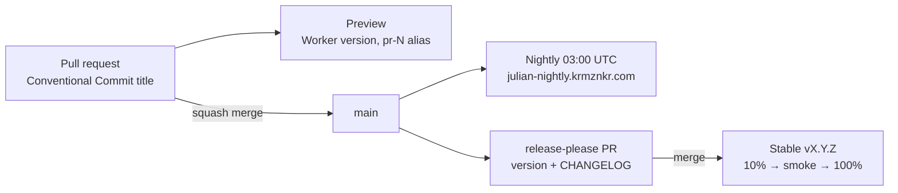

# Releasing

Julian ships from one product version through three channels. Everything here is
automated by GitHub Actions; the only manual step is merging the release PR.



## Versioning

- One version for the product: `version` in the root `package.json`, tracked by
  `.release-please-manifest.json`. Workspace packages stay private at `0.0.0`.
- Semver, read for a web app:

  | Bump  | When                                                         | Commit types                                       |
  | ----- | ------------------------------------------------------------ | -------------------------------------------------- |
  | major | Breaks bookmarks or stored state, or forces OAuth re-consent | `feat!:` / `BREAKING CHANGE:`                      |
  | minor | New user-visible capability                                  | `feat`                                             |
  | patch | Bug fix or performance improvement                           | `fix`, `perf`                                      |
  | none  | Nothing a user could notice                                  | `refactor`, `test`, `docs`, `ci`, `build`, `chore` |

- While the product is `0.x`, `bump-minor-pre-major` turns a breaking change
  into a minor bump instead of jumping to `1.0.0`.
- PRs are squash-merged, so the **PR title** is the commit release-please reads.
  `.github/workflows/pr-title.yml` rejects titles that are not Conventional
  Commits.

## Build metadata

`packages/release` (`@julian/release`) derives the version string for each
channel from the root version (`next-minor` = minor + 1, patch 0):

| Channel   | Version                               | Example                          |
| --------- | ------------------------------------- | -------------------------------- |
| `stable`  | `<version>`                           | `1.4.0`                          |
| `nightly` | `<next-minor>-nightly.YYYYMMDD+<sha>` | `1.5.0-nightly.20261015+0123456` |
| `preview` | `<next-minor>-pr.<N>+<sha>`           | `1.5.0-pr.42+0123456`            |
| `dev`     | `<version>-dev+<sha>`                 | `1.4.0-dev+0123456`              |

Inputs are the env vars `APP_CHANNEL`, `APP_PR_NUMBER` and optionally
`APP_COMMIT`; anything missing means a local `dev` build. Print the values with
`node packages/release/src/cli.ts`.

- **Web:** Vite `define` injects `__APP_VERSION__`, `__APP_CHANNEL__` and
  `__APP_COMMIT__` (`apps/web/build-defines.ts`). The sidebar footer shows the
  version; hover it for channel and commit.
- **Edge:** the Worker serves `GET /version.json`
  (`{ "version", "channel", "commit" }`, `no-store`) from the `APP_*` vars that
  each deploy sets with `wrangler --var`.

## Channels

All deploy paths share `.github/actions/build-web`, which builds for a channel
and **fails if a `GOCSPX-` client secret appears in `apps/web/dist`**, the single
assets directory that holds both the app and the marketing pages. They run
against account `93527c9983d1c08638cb9c1de99f0450` with two tokens:

| Secret                      | Scope                                  | Used by                                              |
| --------------------------- | -------------------------------------- | ---------------------------------------------------- |
| `CLOUDFLARE_API_TOKEN`      | full deploy token (see infrastructure) | jobs in the `production` and `nightly` environments  |
| `CLOUDFLARE_PREVIEW_TOKEN`  | least privilege, no zone or DNS edit   | `preview.yml`, the `infra.yml` plan                  |

Jobs without their token skip with a notice instead of failing. The owner
should store `CLOUDFLARE_API_TOKEN` as an **environment** secret on
`production` and `nightly` (and delete the repository-level copy), and create
`CLOUDFLARE_PREVIEW_TOKEN` as a repository secret with only Workers Scripts
Edit and Account Settings Read on account `93527…`, plus Zone Read and Bot
Management Read if the Alchemy plan should run.

CI also boots the Worker with `wrangler dev` against the fresh build
(`scripts/smoke-edge.sh`) and checks `/version.json` and `/` for a 200 with the
security headers, which catches entry-module errors that only workerd reports.
It also checks that `/demo` and deep demo links such as
`/demo/2026?month=10&day=27&details=false` carry the demo title and `og:url`
`/demo`, that `/2026` keeps the generic shell, and that a missing
`/demo/nope.js` script is a 404.

### Preview (every PR)

`.github/workflows/preview.yml` runs `wrangler versions upload --preview-alias
pr-<N>`: a new version of the production Worker that receives no traffic, reachable
at its preview URL. The workflow comments that URL on the PR and updates the
comment on later pushes. If Preview URLs are disabled for the Worker
(Cloudflare dashboard: Worker > Settings > Domains & Routes), wrangler prints no
URL and the comment gives only the version ID; deploys do not turn them on. Fork
PRs and runs without `CLOUDFLARE_PREVIEW_TOKEN` skip.

Previews run on a `workers.dev` origin that the OAuth origin lock does not
allow (`apps/edge/src/oauth.ts`), so Google sign-in fails there by design; the
demo works.

### Nightly (03:00 UTC)

`.github/workflows/nightly.yml` (also `workflow_dispatch`) skips when `main`
still points at the last `nightly-*` tag. Otherwise it deploys the Worker env
`nightly` (Worker `julian-nightly`, custom domain
`julian-nightly.krmznkr.com`), tags `nightly-YYYYMMDD` and publishes a GitHub
prerelease. A second run on the same day replaces that day's nightly.

Before deploying it copies the `GOOGLE_CLIENT_SECRET` GitHub secret into the
nightly Worker (`wrangler secret put --env nightly`, piped from the environment,
never printed); without that secret it warns and deploys anyway. Nightly never
applies the Alchemy stack: production infrastructure changes only through
**Deploy stable** or a manual **Infra** apply, which share the `alchemy-prod`
concurrency group.

### Stable (release PR merged)

1. `.github/workflows/release-please.yml` keeps a release PR open on `main`
   that bumps `package.json` and the manifest and updates `CHANGELOG.md`.
2. Merging it creates tag `vX.Y.Z` and the GitHub Release, then calls
   `.github/workflows/deploy-stable.yml` with the tag. (Releases published with
   `GITHUB_TOKEN` cannot trigger other workflows, hence the direct call.)
3. The deploy uploads the version, routes **10%** of traffic to it, smoke-tests
   it through the `Cloudflare-Workers-Version-Overrides` header (`/version.json`
   must report the new version; `/` must serve the marketing page and `/demo` the
   app shell), then promotes it
   to **100%**. Any failure puts 100% back on the previous version.
4. The previous version is the one with the largest traffic share in
   `wrangler deployments status`. When there is none (a first deploy), the
   release goes straight to 100%, is smoke-tested there, and has no automatic
   rollback target.

Pushing to `main` no longer deploys production. To redeploy a release by hand,
run **Deploy stable** from the Actions tab with its tag. The workflow rejects
any ref that is not a `vX.Y.Z` tag.

## Validating main by hand

Merge the release PR only when **CI** is green on the exact commit `main`
points at. That commit is not itself tagged or deployed: merging the release PR
adds a new commit on top of it with the version bump and `CHANGELOG.md`, and
release-please tags that merge commit `vX.Y.Z` for **Deploy stable**. The
release commit changes only release metadata, so the application code it ships
is the code on `main` just before the merge, and that is what this check
validates. Green checks on a PR head, or on an older `main` commit, say nothing
about that code.

A push to `main` usually runs CI, but merges made with `GITHUB_TOKEN`, such as
Dependabot auto-merge, do not trigger workflows, so that commit gets no CI
run at all. When `main` has no CI run, start one by hand. This runs the
same three jobs and deploys nothing:

```bash
gh workflow run ci.yml --repo krmznkr/julian --ref main
gh run list --repo krmznkr/julian --workflow ci.yml --branch main \
  --event workflow_dispatch --limit 1 --json headSha,status,conclusion,url
```

The run checks out whatever `main` points at when it starts, so `main` may
have moved since. Right before deciding to merge, read the current `main` from
GitHub rather than a local `origin/main`, which can be stale, and compare:

```bash
main_sha=$(gh api repos/krmznkr/julian/commits/main --jq .sha)
gh run list --repo krmznkr/julian --workflow ci.yml --commit "$main_sha" \
  --json event,status,conclusion,url
```

Merge only if a `push` or `workflow_dispatch` run listed there has
`"conclusion": "success"`. An empty list means no CI run covers the current
`main`: start one and check again. If `main` moves before you merge, repeat the
check for the new commit.

## Rollback

One command, from `apps/edge` with a Workers-scoped token:

```bash
pnpm exec wrangler rollback                  # production: previous version
pnpm exec wrangler rollback --env nightly    # nightly
```

`wrangler rollback <version-id>` targets a specific version; list them with
`pnpm exec wrangler versions list`. Rollback restores code and vars only, which
is what every release changes.

## Break-glass manual deploy

`./scripts/deploy-web.sh` builds as `stable` (override with `APP_CHANNEL`), runs
the same secret check and runs `wrangler deploy` with the matching `APP_*` vars.
It deploys straight to **100%** of production, with no canary and no automatic
rollback, and prints a warning saying so. Use it only when Actions is down.
